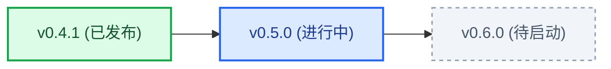

# QuickFieldBrush

QuickFieldBrush 是一个用于 QGIS 的矢量要素属性快速赋值与修改插件，包含右键快速赋值、属性格式刷和操作历史面板。

适用于路网分级、水系等级划分、POI 分类等需要频繁修改属性字段的场景，省去反复打开属性表修改数值的操作。

---

## 功能

### 1. 交互赋值
- 框选要素后右键，直接在弹出的菜单中选择目标属性值完成修改。
- 首次使用或点击菜单顶栏可选择目标字段，系统会按图层分别记住上次选择的字段。
- 排序条支持按字母顺序或按要素出现频次升降序排列候选值。
- 候选值后显示该值在当前图层中的要素统计数量。

### 2. 属性格式刷
- 打开悬浮控制面板后，点击地图上的要素即可将指定字段值写入要素。
- 点击“从要素吸取属性”或在地图上右键单击要素，可直接提取该要素的值到面板中。
- 写入成功后目标要素会有短暂绿色闪烁提示，吸取时为蓝色提示。
- 按 ESC 键可退出格式刷工具。

### 3. 操作历史面板
- 记录单点刷入和框选批量赋值的修改记录，保存修改前后的值。
- 单击记录项：地图自动平移居中并高亮该要素。
- 双击记录项：在图层中选中对应要素。
- 单步还原：点击记录右侧按钮可将单个要素恢复为修改前的值。
- 撤销最新：逆序撤销最新一步操作。
- 导出 CSV：将修改记录导出为 CSV 文件。
- 面板支持图钉置顶，方便悬浮在 QGIS 界面上方使用。

---

## 更新日志

详见 [CHANGELOG.md](CHANGELOG.md)。

- **v0.2.1** (2026-10-26): 安全扫描合规加固。
- **v0.2.0** (2026-10-26): 格式刷面板重构为原生紧凑布局，新增双维动态排序、操作历史面板、要素吸取与多语言支持。
- **v0.1.0** (2026-10-25): 初始版本，支持右键赋值与格式刷基础功能。

---

## 🗺️ 路线图与规划 (Roadmap)

本项目当前处于 **v0.5.0 迭代周期**，正在推进属性表内联快速赋值委托支持。

👉 **查看详细特性矩阵、开发进度条与任务清单**：请参阅 [完整开发路线图 (ROADMAP.md)](ROADMAP.md)。

---

## 安装方法

1. 将 `QuickFieldBrush` 文件夹复制到 QGIS 插件目录：
   - Windows: `C:\Users\<用户名>\AppData\Roaming\QGIS\QGIS3\profiles\default\python\plugins\`
2. 打开 QGIS，进入菜单栏 `插件` -> `管理并安装插件` -> `已安装`，勾选 `QuickFieldBrush` 即可。

---

## 开源许可

MIT License
