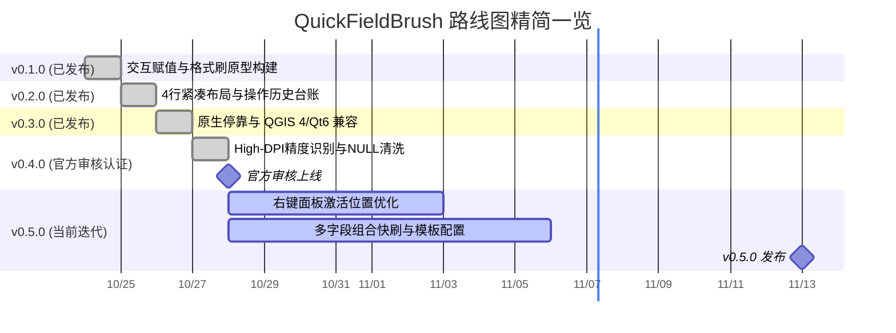

# QuickFieldBrush

  
  
  
  

> 🎉 **项目状态说明 (Project Status)**：  
> - **官方插件主页**：👉 [plugins.qgis.org/plugins/QuickFieldBrush](https://plugins.qgis.org/plugins/QuickFieldBrush/)  
> - **QGIS Plugin 状态**：`Approved & Published`（**已通过 QGIS 官方人工与自动化审核，正式上线官方插件库**）。  
> - **QGIS Version 支持范围**：`≥ 3.16`（实测覆盖 QGIS 3.16 ~ 3.40 LTR，全面兼容 Windows、macOS 与 Linux 环境）。  
> 
> 用户现在可直接在 QGIS 菜单栏选择 **【插件】➔【管理并安装插件】**，在搜索栏输入 **`QuickFieldBrush`** 即可一键在线安装与自动检查升级。亦可在 [Releases 页面](https://github.com/OpenQGIS/QuickFieldBrush/releases) 或官方主页下载最新 ZIP 分发包离线安装。

QuickFieldBrush 是一个用于 QGIS 的矢量要素属性快速赋值与修改插件，包含右键快速赋值、属性格式刷和操作历史面板。

适用于路网分级、水系等级划分、POI 分类等需要频繁修改属性字段的场景，省去反复打开属性表修改数值的操作。

---

## 功能

### 1. 交互赋值
- 框选要素后右键，直接在弹出的菜单中选择目标属性值完成修改。
- 首次使用或点击菜单顶栏可选择目标字段，系统会按图层分别记住上次选择的字段。
- 排序条支持按字母顺序或按要素出现频次升降序排列候选值。
- 候选值后显示该值在当前图层中的要素统计数量。

### 2. 属性格式刷
- 打开悬浮控制面板后，点击地图上的要素即可将指定字段值写入要素。
- 点击“从要素吸取属性”或在地图上右键单击要素，可直接提取该要素的值到面板中。
- 写入成功后目标要素会有短暂绿色闪烁提示，吸取时为蓝色提示。
- 按 ESC 键可退出格式刷工具。

### 3. 操作历史面板
- 记录单点刷入和框选批量赋值的修改记录，保存修改前后的值。
- 单击记录项：地图自动平移居中并高亮该要素。
- 双击记录项：在图层中选中对应要素。
- 单步还原：点击记录右侧按钮可将单个要素恢复为修改前的值。
- 撤销最新：逆序撤销最新一步操作。
- 导出 CSV：将修改记录导出为 CSV 文件。
- 面板支持图钉置顶，方便悬浮在 QGIS 界面上方使用。

---

## 🗺️ 路线图与规划 (Roadmap)

本项目当前处于 **v0.5.0 迭代周期**，正在推进 **右键面板激活位置优化** 与 **多字段组合快刷**。

👉 **查看详细特性矩阵、开发进度条与任务清单**：请参阅 [完整开发路线图 (ROADMAP.md)](ROADMAP.md)。

---

## 更新日志

详见 [CHANGELOG.md](CHANGELOG.md)。

- **v0.4.0** (2026-10-27): 右键菜单与格式刷全链路支持【设为 NULL / 清空字段】，智能过滤与规整假空值，历史台账标准化展示。
- **v0.3.0** (2026-10-27): 格式刷控制台与历史面板支持 QgsDockWidget 原生停靠与悬浮切换，收窄宽度为 310/320px。
- **v0.2.1** (2026-10-26): 安全扫描合规加固。
- **v0.2.0** (2026-10-26): 格式刷面板重构为原生紧凑布局，新增双维动态排序、操作历史面板、要素吸取与多语言支持。
- **v0.1.0** (2026-10-25): 初始版本，支持右键赋值与格式刷基础功能。

---

## 运行要求与状态 (Requirements & Status)

- **官方插件主页**：[https://plugins.qgis.org/plugins/QuickFieldBrush/](https://plugins.qgis.org/plugins/QuickFieldBrush/)
- **QGIS Plugin 状态**：`Approved`（已通过官方审核，正式收录于 QGIS 官方插件仓库）
- **QGIS Version 支持**：`≥ 3.16`（全面适配 3.16、3.22、3.28、3.34、3.40 LTR 等版本）
- **操作系统**：Windows 10/11、macOS (Intel / Apple Silicon)、Linux

---

## 安装方法

### 方式一：QGIS 官方插件管理器在线安装（推荐）

1. 打开 QGIS，在顶部菜单栏依次点击 **【插件】➔【管理并安装插件...】**。
2. 切换至 **【全部】** 选项卡，在搜索框中输入 `QuickFieldBrush`。
3. 选中插件并点击右下角 **【安装插件】** 即可完成安装，未来享有官方一键更新推送。

### 方式二：从 ZIP 压缩包安装（离线安装）

1. 前往 [QGIS 官方插件主页](https://plugins.qgis.org/plugins/QuickFieldBrush/) 或 [Releases 页面](https://github.com/OpenQGIS/QuickFieldBrush/releases) 下载最新 ZIP 分发包。
2. 打开 QGIS 菜单栏 **【插件】➔【管理并安装插件...】➔【从 ZIP 文件安装】**。
3. 选取下载的 ZIP 文件并点击 **【安装插件】** 即插即用。

### 方式三：手动目录部署（开发与调试）

1. 将 `QuickFieldBrush` 文件夹复制到 QGIS 插件目录：
   - Windows: `C:\Users\<用户名>\AppData\Roaming\QGIS\QGIS3\profiles\default\python\plugins\`
   - macOS: `~/Library/Application Support/QGIS/QGIS3/profiles/default/python/plugins/`
   - Linux: `~/.local/share/QGIS/QGIS3/profiles/default/python/plugins/`
2. 打开 QGIS，进入菜单栏 **【插件】➔【管理并安装插件】➔【已安装】**，勾选 `QuickFieldBrush` 即可。

---

## 开源许可

GNU Affero General Public License v3.0 (AGPL-3.0-or-later)
