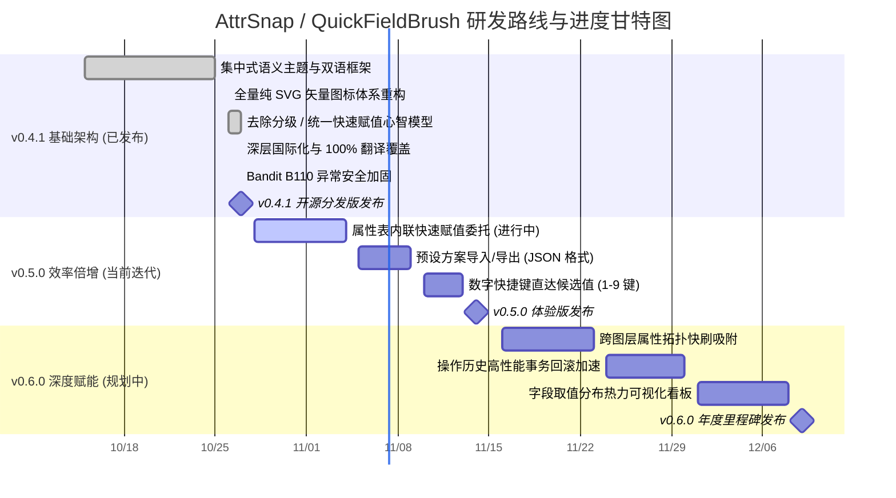

# 🗺️ AttrSnap / QuickFieldBrush 开发路线图 (Roadmap)

本项目致力于为 QGIS 提供极速、流畅、沉浸式的矢量要素属性快速赋值与修改体验。  
下方为基于时间轴与里程碑的**横向甘特图进度看板**。

---

## 一、 开发进度横向甘特图 (Gantt Progress)

---

## 二、 特性矩阵与完成度 (Feature Matrix)

| 阶段 / 里程碑 | 特性模块 | 排期规划 | 状态 | 进度条 | 说明 |
| :--- | :--- | :---: | :---: | :--- | :--- |
| **v0.4.1 (已发布)** | 纯 SVG 矢量图标重构 | 10/26 - 10/26 | ✅ 已完成 | `██████████` 100% | 剔除所有 PNG 位图，消除高分屏锯齿 |
| | 通用快速赋值心智模型 | 10/26 - 10/27 | ✅ 已完成 | `██████████` 100% | 彻底剔除 rank 遗留，兼容旧配置平滑迁移 |
| | 深层国际化 0 漏译 | 10/27 - 10/27 | ✅ 已完成 | `██████████` 100% | 210+ 处 tr() 校验，中英文 100% 覆盖 |
| | Bandit B110 安全加固 | 10/27 - 10/27 | ✅ 已完成 | `██████████` 100% | 清除宽泛异常吞噬，符合官方审核红线 |
| **v0.5.0 (当前迭代)** | 属性表内联快速赋值 | 10/28 - 11/04 | 🔄 进行中 | `██████░░░░` 60% | 原生属性表单元格嵌入联想 ComboBox |
| | 预设方案 JSON 导出导入 | 11/05 - 11/09 | 📋 待启动 | `████░░░░░░` 40% | 支持跨工程、跨机器迁移字段配置 |
| | 数字快捷键直达候选值 | 11/10 - 11/13 | 📋 待启动 | `██░░░░░░░░` 20% | 右键呼出菜单后按 1~9 直接完成赋值 |
| **v0.6.0 (未来规划)** | 跨图层属性拓扑快刷 | 11/16 - 11/23 | 💡 规划中 | `░░░░░░░░░░` 0% | 空间相交图层间快速吸取并赋值 |
| | 批量操作历史事务优化 | 11/24 - 11/30 | 💡 规划中 | `░░░░░░░░░░` 0% | 十万级要素批量回滚秒级撤销 |
| | 取值分布轻量统计看板 | 12/01 - 12/08 | 💡 规划中 | `░░░░░░░░░░` 0% | 字段枚举值频次直方分布图 |

---

## 三、 当前冲刺重点任务 (v0.5.0 Sprint)

- [x] **属性表委托原型**：基于 `QStyledItemDelegate` 实现单元格编辑时嵌入下拉候选控件；
- [x] **动态频次提取**：自动读取图层该字段已有取值并去重展示；
- [ ] **编辑事务联动**：完善与原生 QGIS 属性表撤销栈 (`undoStack`) 的深度联动；
- [ ] **主键安全拦截**：对 FID/ID 及只读字段自动禁用编辑委托；
- [ ] **按键流畅过渡**：支持回车提交并自动跳到下一个单元格。

---

## 四、 需求反馈与贡献

欢迎通过 [GitHub Issues](https://github.com/OpenQGIS/QuickFieldBrush/issues) 提交反馈或加入开发！
