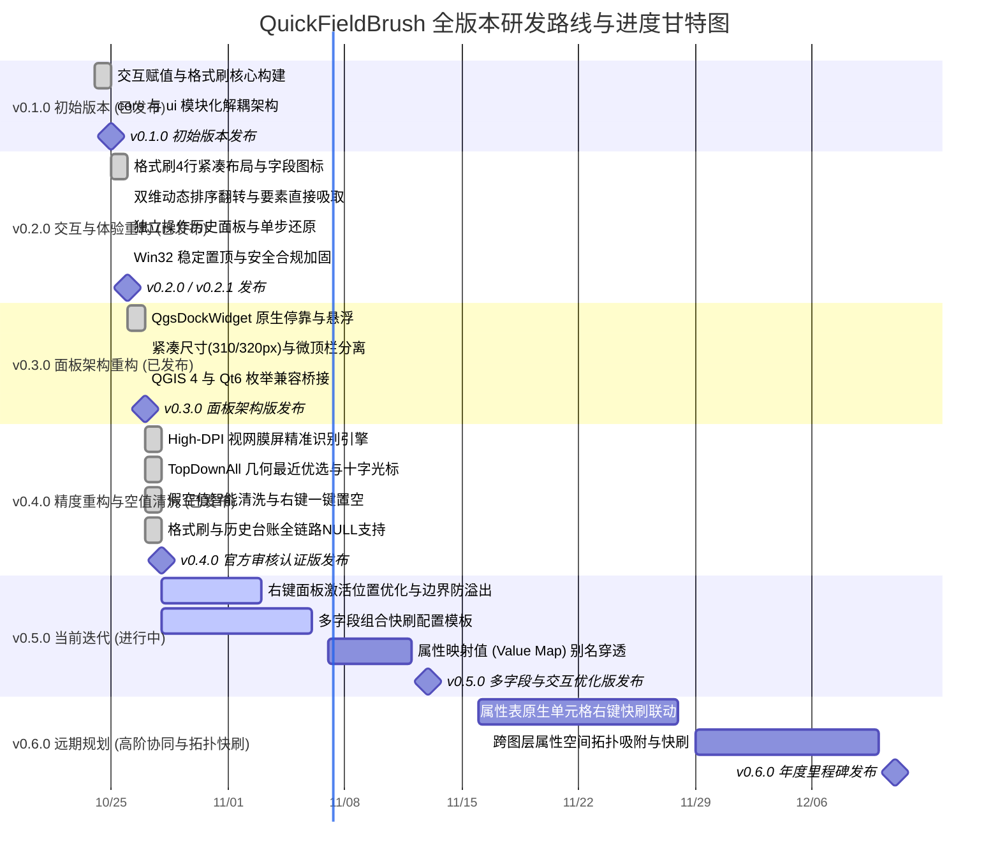

# QuickFieldBrush 研发路线图 (Roadmap)

本文档规划了 **QuickFieldBrush** 插件的功能迭代蓝图、版本演进历史、当前冲刺进度及远期演进目标。

---

## 一、 研发周期横向甘特图 (Mermaid Gantt)

---

## 二、 特性矩阵与进度指标 (Feature Matrix)

统一采用 10 段式 Unicode 进度条展示特性成熟度：

| 阶段 / 里程碑 | 特性模块 | 排期规划 | 状态 | 进度条 | 说明与技术攻关点 |
| :--- | :--- | :---: | :---: | :--- | :--- |
| **v0.1.0 (已发布)** | **原型验证与核心工具** | 10/24 - 10/25 | ✅ 已发布 | `██████████` 100% | 框选右键交互赋值、属性格式刷连续刷入，解耦 core 业务与 ui 组件 |
| **v0.2.0 (已发布)** | **界面紧凑重构与操作历史** | 10/25 - 10/26 | ✅ 已发布 | `██████████` 100% | 4 行紧凑布局、14 种矢量字段类型图标、双维排序翻转、要素吸取与历史撤销台账 |
| **v0.2.1 (已发布)** | **安全扫描与规范加固** | 10/26 - 10/26 | ✅ 已发布 | `██████████` 100% | 消除通用异常静默捕获，通过 Bandit / detect-secrets / Flake8 官方安全门禁 |
| **v0.3.0 (已发布)** | **原生停靠与尺寸收窄** | 10/26 - 10/27 | ✅ 已发布 | `██████████` 100% | 升级 QgsDockWidget 原生停靠，收窄为 310/320px 紧凑面板，Qt6 与 QGIS 4 枚举兼容 |
| **v0.4.0 (已发布)** | **High-DPI 精度与空值清洗** | 10/27 - 10/28 | ✅ 已发布 | `██████████` 100% | QgsMapToolIdentify 重构、Mac/4K 坐标防漂移、TopDownAll 几何最近优选、全链路真 NULL 支持与假空值规整 |
| **v0.5.0 (当前迭代)** | **右键面板激活位置优化** | 10/28 - 11/03 | 🔄 进行中 | `████░░░░░░` 40% | 智能边缘检测、屏幕边界防溢出，自适应鼠标光标与选区中心 |
| **v0.5.0 (当前迭代)** | **多字段组合快刷** | 10/28 - 11/06 | 🔄 进行中 | `██░░░░░░░░` 20% | 支持一次框选或单点同时刷入关联的多字段属性包 |
| **v0.5.0 (下期迭代)** | **ValueMap 枚举与别名穿透** | 11/07 - 11/12 | 💡 待启动 | `░░░░░░░░░░` 0% | 解析 QGIS 字段表单值映射配置，展示业务别名并写入底层代号 |
| **v0.6.0 (远期规划)** | **属性表交互联动** | 11/16 - 11/28 | 💡 待启动 | `░░░░░░░░░░` 0% | 原生属性表单元格嵌入右键快速赋值与分类菜单 |
| **v0.6.0 (远期规划)** | **跨图层空间拓扑吸附** | 11/29 - 12/10 | 💡 待启动 | `░░░░░░░░░░` 0% | 支持从底图图层空间相交相碰要素中自动吸取属性赋给当前图层 |

---

## 三、 迭代任务与冲刺清单 (Sprint Tasks)

- [ ] **右键面板激活位置优化 (v0.5.0)**：计算屏幕可见工作区与地图画布边界，防止右键菜单超出屏幕边缘，自适应光标与选区重心；
- [ ] **多字段联合快速赋值 (v0.5.0)**：设计多属性字段联动配置包，实现一次框选批量写入多个关联字段；
- [ ] **ValueMap 别名穿透 (v0.5.0)**：映射 QGIS 预设别名并自动转换底层存储值；
- [x] **High-DPI 跨平台精准识别 (v0.4.0)**：QgsMapToolIdentify 重构，彻底消除 Mac 视网膜屏与 Windows 缩放下的坐标漂移；
- [x] **TopDownAll 几何最近优选 (v0.4.0)**：计算欧氏距离匹配最近线与最小图斑，搭配 CrossCursor 十字光标解决相邻细线误选；
- [x] **过滤与规整假空值 (v0.4.0)**：统一识别并在唯一值提取时排除 `"NULL"`、`"null"` 及空白纯空格；
- [x] **右键菜单一键置空 (v0.4.0)**：在右键极速菜单底部新增【设为 NULL / 清空字段】快捷操作；
- [x] **格式刷控制台集成 NULL (v0.4.0)**：新增【设为 NULL】快捷按钮与下拉选项，支持清空刷入模式；
- [x] **QgsDockWidget 原生停靠 (v0.3.0)**：格式刷控制台与历史面板支持 QGIS 原生停靠与悬浮自由切换；
- [x] **界面收窄与顶栏分离 (v0.3.0)**：将面板宽度收窄至 310/320px，置顶图钉独立为微顶栏；
- [x] **Qt6 与 QGIS 4 枚举兼容 (v0.3.0)**：新增 `compat.py` 强类型枚举兼容桥接机制；
- [x] **安全扫描与规范合规 (v0.2.1)**：通过 Bandit / detect-secrets / Flake8 代码门禁，实现 0 告警；
- [x] **操作历史台账与单步撤销 (v0.2.0)**：完整记录修改台账，支持地图居中高亮、双击选区、单步还原与 CSV 导出；
- [x] **4 行紧凑布局与 14 种字段图标 (v0.2.0)**：格式刷重构为原生紧凑布局，引入全套矢量字段类型图标；
- [x] **双维动态排序翻转与要素直接吸取 (v0.2.0)**：支持字母/频次升降序切换与画布要素右键直接吸取属性；
- [x] **初始功能构建与 core/ui 解耦 (v0.1.0)**：实现右键交互赋值与格式刷连续刷入核心能力。

---

## 四、 贡献与建议

欢迎通过 GitHub Issues 提交功能建议或缺陷反馈：
👉 [提交 Issue / Feature Request](https://github.com/OpenQGIS/QuickFieldBrush/issues)
