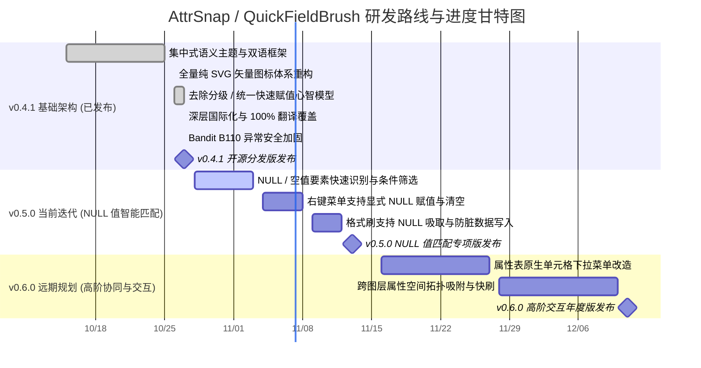

# 🗺️ AttrSnap / QuickFieldBrush 开发路线图 (Roadmap)

本项目致力于为 QGIS 提供极速、流畅、沉浸式的矢量要素属性快速赋值与修改体验。  
下方为基于时间轴与里程碑的**横向甘特图进度看板**。

---

## 一、 开发进度横向甘特图 (Gantt Progress)

---

## 二、 特性矩阵与开发进度 (Feature Matrix)

| 阶段 / 里程碑 | 特性模块 | 排期规划 | 状态 | 进度条 | 说明 |
| :--- | :--- | :---: | :---: | :--- | :--- |
| **v0.4.1 (已发布)** | 纯 SVG 矢量图标体系 | 10/26 - 10/26 | ✅ 已完成 | `██████████` 100% | 彻底剔除所有 PNG 位图，消除高分屏锯齿 |
| | 通用快速赋值心智模型 | 10/26 - 10/27 | ✅ 已完成 | `██████████` 100% | 消除 rank 遗留，兼容旧配置平滑迁移 |
| | 深层国际化 0 漏译校验 | 10/27 - 10/27 | ✅ 已完成 | `██████████` 100% | 210+ 处 tr() 校验，中英文 100% 覆盖 |
| | Bandit B110 安全加固 | 10/27 - 10/27 | ✅ 已完成 | `██████████` 100% | 清除宽泛异常吞噬，符合官方审核红线 |
| **v0.5.0 (当前迭代)** | **NULL 值智能匹配与筛选** | 10/28 - 11/03 | 🔄 进行中 | `████░░░░░░` 40% | 支持一键框选/过滤字段为 NULL 的待补录要素 |
| | **显式写入 NULL 与快速清空** | 11/04 - 11/08 | 📋 待启动 | `██░░░░░░░░` 20% | 菜单提供独立 NULL 项，支持将属性重置为真实空值 |
| | **格式刷安全吸取与清空** | 11/09 - 11/12 | 📋 待启动 | `░░░░░░░░░░` 0% | 吸取空值要素时正确传递 NULL，杜绝字符串 "None" |
| **v0.6.0 (远期规划)** | **属性表下拉菜单改造** | 11/16 - 11/27 | 💡 规划中 | `░░░░░░░░░░` 0% | 原生属性表单元格嵌入带联想过滤的枚举下拉框 |
| | **跨图层属性拓扑吸附** | 11/28 - 12/10 | 💡 规划中 | `░░░░░░░░░░` 0% | 空间相交/重叠时直接跨图层吸取参考属性写入目标要素 |

---

## 三、 当前冲刺重点任务 (v0.5.0 Sprint - NULL 值匹配)

- [ ] **待补全要素快速聚焦**：在地图工具与菜单中支持【仅匹配目标字段为 NULL】的高亮模式，精准定位未录入要素；
- [ ] **区分空字符串与真实 NULL**：写入底层要素时严格区分数据库 `NULL` (`QVariant()`) 与空文本 `""`；
- [ ] **右键菜单项增强**：在候选值列表顶部/底部常驻【设为 NULL】选项；
- [ ] **格式刷吸取保护**：吸取空要素属性时支持安全赋 NULL，避免格式刷中断或异常抛错。

---

## 四、 需求反馈与贡献

欢迎通过 [GitHub Issues](https://github.com/OpenQGIS/QuickFieldBrush/issues) 提交反馈或加入开发！
