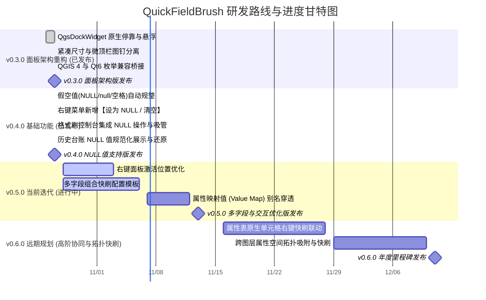

# QuickFieldBrush 研发路线图 (Roadmap)

本文档规划了 **QuickFieldBrush** 插件的功能迭代蓝图、当前冲刺进度及远期演进目标。

---

## 一、 研发周期横向甘特图 (Mermaid Gantt)

---

## 二、 特性矩阵与进度指标 (Feature Matrix)

统一采用 10 段式 Unicode 进度条展示特性成熟度：

| 阶段 / 里程碑 | 特性模块 | 排期规划 | 状态 | 进度条 | 说明与技术攻关点 |
| :--- | :--- | :---: | :---: | :--- | :--- |
| **v0.3.0 (已发布)** | **原生停靠与尺寸收窄** | 10/26 - 10/27 | ✅ 已发布 | `██████████` 100% | 升级 QgsDockWidget 原生停靠，收窄为 310/320px 紧凑面板 |
| **v0.4.0 (已发布)** | **NULL 值智能支持与清洗** | 10/27 - 10/27 | ✅ 已发布 | `██████████` 100% | 过滤脏文本字面量，右键与格式刷全链路支持一键置为真 NULL |
| **v0.5.0 (当前迭代)** | **右键面板激活位置优化** | 10/28 - 11/03 | 🔄 进行中 | `████░░░░░░` 40% | 智能边缘检测、屏幕边界防溢出，自适应鼠标光标与选区中心 |
| **v0.5.0 (当前迭代)** | **多字段组合快刷** | 10/28 - 11/06 | 🔄 进行中 | `██░░░░░░░░` 20% | 支持一次框选或单点同时刷入关联的多字段属性包 |
| **v0.5.0 (下期迭代)** | **ValueMap 枚举与别名穿透** | 11/07 - 11/12 | 💡 待启动 | `░░░░░░░░░░` 0% | 解析 QGIS 字段表单值映射配置，展示业务别名并写入底层代号 |
| **v0.6.0 (远期规划)** | **属性表交互联动** | 11/16 - 11/28 | 💡 待启动 | `░░░░░░░░░░` 0% | 原生属性表单元格嵌入右键快速赋值与分类菜单 |
| **v0.6.0 (远期规划)** | **跨图层空间拓扑吸附** | 11/29 - 12/10 | 💡 待启动 | `░░░░░░░░░░` 0% | 支持从底图图层空间相交相碰要素中自动吸取属性赋给当前图层 |

---

## 三、 当前冲刺重点任务 (v0.5.0 Sprint)

- [ ] **右键面板激活位置优化**：计算屏幕可见工作区与地图画布边界，防止右键菜单超出屏幕边缘，自适应光标与选区重心；
- [ ] **多字段联合快速赋值**：设计多属性字段联动配置包，实现一次框选批量写入多个关联字段；
- [x] **过滤与规整假空值 (v0.4.0)**：统一识别并在唯一值提取时排除 `"NULL"`、`"null"` 及空白纯空格；
- [x] **右键菜单一键置空 (v0.4.0)**：在右键极速菜单底部新增【设为 NULL / 清空字段】快捷操作；
- [x] **格式刷控制台集成 NULL (v0.4.0)**：新增【设为 NULL】快捷按钮与下拉选项，支持清空刷入模式。

---

## 四、 贡献与建议

欢迎通过 GitHub Issues 提交功能建议或缺陷反馈：
👉 [提交 Issue / Feature Request](https://github.com/OpenQGIS/QuickFieldBrush/issues)
