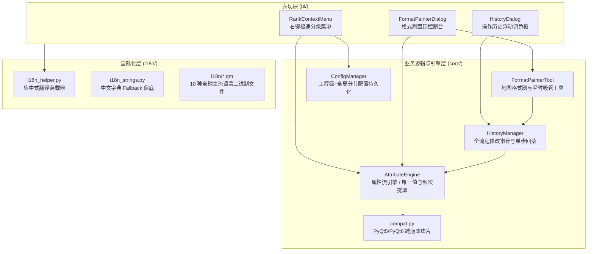

# QuickFieldBrush 架构设计与技术规范文档

> 版本：v0.2.0 ｜ 状态：正式发布 ｜ 日期：2026-10-26
> 定位：专为 QGIS 打造的高生产力矢量要素交互赋级、属性格式刷与历史回溯工具集。

---

## 一、系统总体架构与模块分工

QuickFieldBrush 采用严格的 MVC 分层解耦设计，跨环境兼容 QGIS 3 (PyQt5) 与 QGIS 4 (PyQt6)：

### 1.1 核心模块职能清单

| 模块文件 | 核心职能 | 关键设计模式与性能策略 |
|---|---|---|
| `plugin.py` | 插件生命周期管理、工具栏与菜单入口挂载 | 无感加载、`unload()` 干净注销翻译器与地图工具 |
| `core/map_tool.py` | 框选交互赋级地图工具 | 空间矩形范围快速拾取、Shift 并集 / Ctrl 对称差 |
| `core/format_painter_tool.py` | 格式刷地图作业工具 | `QgsFeatureRequest.setFilterRect` 走空间索引快速命中；左键刷属性、右键瞬时吸管；绿色赋属性反馈、蓝色吸取反馈 |
| `core/attribute_engine.py` | 矢量数据操作核心底座 | 强类型安全转换 (`convertCompatible`)；`NoGeometry` 属性流提取唯一值与出现频次；会话级内存缓存 |
| `core/history_manager.py` | 操作历史审计与撤销栈 | 全流程修改记录、单步精准还原 (`Revert`)、逆序撤销最新修改、CSV UTF-8 BOM 导出 |
| `core/config_manager.py` | 用户偏好持久化 | 按图层独立记忆目标字段与排序规则；工程级与全局级配置合并 |
| `core/compat.py` | QGIS 跨版本兼容垫片 | 抹平 Qt5 / Qt6 差异，导出统一的 `QAction`、`safe_exec` |
| `ui/rank_context_menu.py` | 右键极速分级菜单 | 2 按钮智能翻转排序条；深黑属性值与中灰统计频次分离；原生字段类型图标 |
| `ui/format_painter_dialog.py` | 格式刷无模态常驻控制台 | 原生 4 行流式布局；零闪烁 Win32 API 置顶图钉；动态唯一值下拉与新值自定义 |
| `ui/history_dialog.py` | Illustrator 风格历史面板 | 独立悬浮无模态调色板；单击地图居中闪烁、双击选中要素；搜索过滤 |

---

## 二、核心作业模式技术规范

### 2.1 交互赋级工具 (Interactive Ranking)
* **显式字段引导**：激活工具或右键呼出时，校验图层配置。初次激活弹出原生字段选择器，显示 QGIS 14 种矢量字段类型图标（`123`/`abc`/`1.2`），按图层独立记忆；
* **双维度两态翻转排序条 (2-Button Dynamic Sort)**：
  - **字母维** (`sort-AZ.svg` ⇋ `sort-reverse-ZA.svg`)：文本升降序；
  - **频次维** (`sort-dscend.svg` ⇋ `sort-ascend.svg`)：要素真实出现频次多/少；
  - 原地无缝重排菜单候选项，自适应尺寸，零闪烁、不丢失鼠标焦点；
* **色彩分离规约**：属性值为主体深黑（`#0F172A`），统计频次为中灰（`#718096`），鼠标悬浮为 QGIS 原生选中蓝（`#0078D7`）。

### 2.2 属性格式刷工具 (Format Painter)
* **无模态置顶控制台**：
  - 采用底层 Win32 API `SetWindowPos(HWND_TOPMOST)` 实现零闪烁置顶；
  - 布局精简为 4 行：① 目标字段+图钉，② 属性值+双排序按钮，③ 当前刷入状态，④ 底部左吸取右退出；
* **真·吸取机制 (Real Eyedropper)**：
  - 点击【从要素吸取属性】进入吸管模式，点击地图要素直接读取其值并填入下拉框，不修改该要素；
  - 支持**右键瞬时吸管**：连续作业中，左键刷入、右键吸取，无需在面板上频繁切换；
  - 赋入呈现 180ms 绿色高亮闪烁，吸取呈现 250ms 蓝色高亮动画。

### 2.3 操作历史浮动面板 (History Palette)
* **全流程修改审计**：单点刷入与框选批量修改均被结构化记入历史栈；
* **地图联动与回滚**：
  - 单击记录项：毫秒级平移居中并闪烁高亮；
  - 双击记录项：激活该图层并在地图上选中要素；
  - 单步还原：点击卡片右侧 `↺` 精准回滚单个要素到修改前原值；
  - 撤销最新：逆序撤销最新一步操作；
  - CSV 导出：带 UTF-8 BOM，Excel 双击打开不乱码。

---

## 三、国际化与多语言 (i18n) 体系

* **集中装载机制** (`i18n_helper.py`)：自动检测 `QgsSettings` 或系统 Locale，动态匹配加载对应 `.qm` 文件；
* **双保险保底** (`i18n_strings.py`)：在中文环境下即便 `.qm` 文件缺失，通过内置静态字典保证 100% 汉化；
* **全球 10 大语系覆盖**：`zh_CN`, `zh_TW`, `ja`, `ko`, `es`, `fr`, `de`, `ru`, `pt`, `it`，全套配齐 `.ts` 源码与 `.qm` 二进制。

---

## 四、工程与分发规范

* **开发源码路径**：`C:\Users\tesla\AppData\Roaming\QGIS\QGIS3\profiles\ForTest\python\plugins\QuickFieldBrush`
* **Git 托管仓库**：`D:\GitHub\QuickFieldBrush`（远程：`https://github.com/OpenQGIS/QuickFieldBrush`）
* **分发与发布根目录**：`E:\QGIS文章\OpenQGIS_Lab\OpenQGIS_QGISPlugins_LAB\QuickFieldBrush`
  - `QuickFieldBrush-4QGIS/`：纯净功能包，顶级解压目录 `QuickFieldBrush/`，POSIX `/` 斜杠；
  - `QuickFieldBrush_History/`：开发历史全量备份归档；
  - 归档与发布压缩包统一命名：**`QuickFieldBrush_V-X.Y.Z.zip`**。
